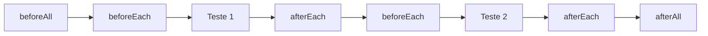

---
layout: section
index: "T"
title: Teoria
---

---
layout: lead
index: "01"
kicker: Testes previsíveis
title: Preparar o cenário. Testar. Limpar.
subtitle: Hooks de ciclo de vida no Jest
---

---
layout: default
title: Por que usar hooks?
---

- **Preparar** o estado antes dos testes.
- **Repetir** uma preparação sem duplicar código.
- **Limpar** dados temporários depois de cada caso.
- **Abrir e fechar** recursos compartilhados uma única vez.

<Callout icon="lucide:rotate-ccw">Cada teste deve começar em um estado conhecido e não depender do teste anterior.</Callout>

---
layout: columns
kicker: Ciclo de vida
title: Quatro momentos, duas frequências
columns:
  - title: A cada teste
    items:
      - "beforeEach"
      - "afterEach"
  - title: Uma vez por bloco
    items:
      - "beforeAll"
      - "afterAll"
---

---
layout: section
index: "02"
title: beforeEach
---

---
layout: define
kicker: Antes de cada teste
term: beforeEach
definition: Executa uma função antes de cada teste do arquivo ou do bloco `describe`.
points:
  - "Bom para criar dados novos e independentes."
  - "Também aguarda uma Promise retornada."
---

---
layout: code
title: Sintaxe de beforeEach
---

```js[font=large]
beforeEach(() => {
  carrinho = [];
});

test('adiciona um produto', () => {
  carrinho.push(produto);
  expect(carrinho).toHaveLength(1);
});
```

---
layout: code
title: Exemplo — estoque inicial conhecido
---

```js[font=large]
const Produto = require('./Produto');
let produto;

beforeEach(() => {
  produto = new Produto('p1', 'Café', 20, 5);
});

test('diminui o estoque', () => {
  produto.diminuirEstoque(2);
  expect(produto.estoque).toBe(3);
});
```

---
layout: section
index: "03"
title: afterEach
---

---
layout: define
kicker: Depois de cada teste
term: afterEach
definition: Executa uma função após cada teste do arquivo ou do bloco `describe`.
points:
  - "Bom para remover dados temporários."
  - "Pode restaurar mocks, timers ou estado compartilhado."
---

---
layout: code
title: Sintaxe de afterEach
---

```js[font=large]
afterEach(() => {
  removerDadosTemporarios();
});
```

---
layout: code
title: Exemplo — limpar a lista de produtos
---

```js[font=large]
const Produto = require('./Produto');
const produtosCriados = [];

afterEach(() => {
  produtosCriados.length = 0;
});

test('registra um produto para o teste', () => {
  produtosCriados.push(new Produto('p1', 'Café', 20, 5));
  expect(produtosCriados).toHaveLength(1);
});
```

---
layout: section
index: "04"
title: beforeAll
---

---
layout: define
kicker: Uma vez antes dos testes
term: beforeAll
definition: Executa uma função uma vez antes dos testes do arquivo ou do bloco `describe`.
points:
  - "Bom para iniciar um recurso compartilhado e caro."
  - "Os testes devem evitar alterar dados compartilhados."
---

---
layout: code
title: Sintaxe de beforeAll
---

```js[font=large]
beforeAll(() => {
  abrirConexao();
});
```

---
layout: code
title: Exemplo — catálogo compartilhado
---

```js[font=large]
const Produto = require('./Produto');
let catalogo;

beforeAll(() => {
  catalogo = [new Produto('p1', 'Café', 20, 5)];
});

test('catálogo contém o café', () => {
  expect(catalogo[0].nome).toBe('Café');
});
```

---
layout: section
index: "05"
title: afterAll
---

---
layout: define
kicker: Uma vez depois dos testes
term: afterAll
definition: Executa uma função uma vez depois que todos os testes do arquivo ou do bloco `describe` terminam.
points:
  - "Bom para fechar conexões e remover recursos compartilhados."
  - "Aguarda uma Promise retornada antes de concluir."
---

---
layout: code
title: Sintaxe de afterAll
---

```js[font=large]
afterAll(async () => {
  await fecharConexao();
});
```

---
layout: code
title: Exemplo — fechar um recurso
---

```js[font=large]
let conexao;

beforeAll(async () => {
  conexao = await abrirConexao();
});

afterAll(async () => {
  await conexao.fechar();
});
```

---
layout: section
index: "D"
title: Desenvolvimento
---

---
layout: default
kicker: Frequência dos hooks
title: A ordem em um arquivo de testes
note: beforeAll e afterAll envolvem o conjunto; beforeEach e afterEach envolvem cada teste.
---



---
layout: code
title: Exemplo — beforeEach e afterEach
---

```js[font=large]
let produto;

beforeEach(() => {
  produto = new Produto('p1', 'Café', 20, 5);
});

afterEach(() => {
  produto = undefined;
});

test('aplica desconto de 10%', () => {
  produto.aplicarDesconto(10);
  expect(produto.preco).toBe(18);
});
```

---
layout: code
title: Exemplo — beforeAll e afterAll
---

```js[font=large]
const Produto = require('./Produto');
let catalogo;

beforeAll(() => {
  catalogo = [new Produto('p1', 'Café', 20, 5)];
});

afterAll(() => {
  catalogo = undefined;
});

test('o catálogo tem um produto', () => {
  expect(catalogo).toHaveLength(1);
});
```

---
layout: section
index: "H"
title: Hands-On
---

---
layout: default
title: Atividade — ciclo de vida no e-commerce
class: "!px-8"
---

A classe `Produto` já existe e exporta `aplicarDesconto(porcentagem)` e `diminuirEstoque(qtd)`.

- Crie `Produto.test.js` e importe a classe existente.
- Use `beforeEach` para criar um produto com estoque 5 e preço 100.
- Teste desconto de 10% e redução de 2 unidades; confira preço 90 e estoque 3.
- Use `afterEach` para limpar qualquer lista.
- Use `beforeAll` para preparar um catálogo compartilhado com dois produtos.
- Use `afterAll` para liberar o recurso criado uma única vez.
- Execute os testes mais de uma vez e confirme que o resultado não depende da ordem.

---
layout: code
title: Ponto de partida — Produto.test.js
---

```js[font=normal]
const Produto = require('./Produto');

let produto;

beforeEach(() => {
  // Crie um Produto novo antes de cada teste.
});

afterEach(() => {
  // Limpe estado temporário deste teste.
});

test('aplica desconto', () => {
  // Verifique o preço após 10% de desconto.
});

test('diminui estoque', () => {
  // Verifique o estoque após retirar 2 unidades.
});
```

---
layout: feature
kicker: Encerramento
title: Obrigado!
columns: 2
features:
  - { icon: "lucide:globe", title: "Site", desc: filipefernandesphd.com }
  - { icon: "lucide:instagram", title: "Instagram", desc: "@filipfernandesphd" }
---

---
layout: two-cols
title: Avaliação da Experiência de Aprendizagem
---

- **[Seu feedback é muito importante!](https://forms.gle/CMfL5oTm235FfuH59)**
- Obtenha o código da avaliação

::right::


