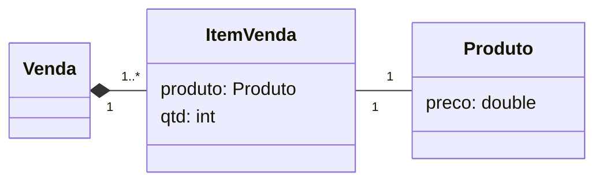

---
layout: section
index: "T"
title: "Teoria"
---

---
layout: default
title: "Desenvolvimento Dirigido por Testes (TDD)"
---

- Do inglês, **Test Driven Development**.
- Uma das práticas de programação propostas por **Extreme Programming (XP)**.
- Ideia central: **escrever teste unitário antes do código**.

---
layout: default
title: "Objetivos"
---
<v-clicks>

- Evita que os desenvolvedores esqueçam de escrever testes. 
- Favorece a escrita de código com alta testabilidade.
- Contribui com a melhoria do design de um sistema:
  - *Desenvolvedor assume o papel de usuário (indiretamente)*

</v-clicks>

---
layout: default
title: "Clicos de TDD"
---

---
layout: section
title: "Desenvolvimento"
index: "D"
---

---
layout: default
title: "Desenvolvimento"
---

- Implemente o cenário abaixo com TDD.

---
layout: section
title: "Hands-On"
index: "H"
---

---
layout: default
title: "Hands-On"
---
- Crie um projeto simples em qualquer linguagem usando TDD. 

---
layout: feature
kicker: Encerramento
title: Obrigado!
columns: 2
features:

- { icon: "lucide:globe", desc: filipefernandesphd.com }
- { icon: "lucide:instagram", desc: "@filipfernandesphd" }

---

---
layout: two-cols
title: Avaliação da Experiência de Aprendizagem
---

- **[Seu feedback é muito importante!](https://forms.gle/CMfL5oTm235FfuH59)**
- Obtenha o código da avaliação

::right::

