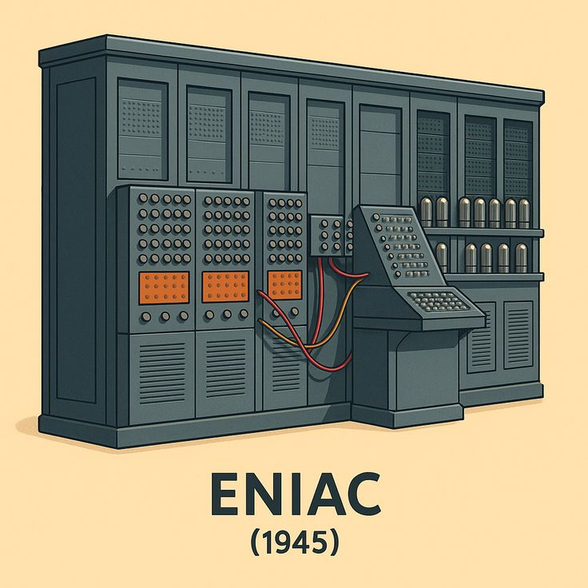
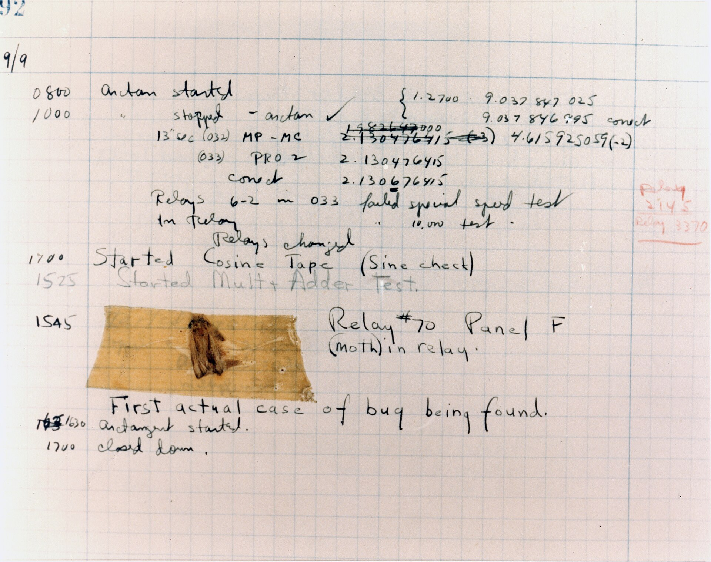

---
layout: section
title: "Manutenção de Software"
---

---
layout: section
index: "01"
title: "Bug"
---

---
layout: two-cols
title: "Bug"
---

::right::

---
layout: two-cols
title: "O primeiro bug"
---

- **Grace Hopper**, Harvard, **1947**.
- Programas de um grande computador **não funcionavam corretamente**.
- Causa: uma **mariposa** presa em um **relé eletromecânico**.
- Primeiro caso real de um **bug** [@manusoft-livro].

::right::

---
layout: default
---

---
layout: section
index: "02"
title: "Bugs Conhecidos"
---

---
layout: default
title: "Ariane 5 (1996)"
---

- Foguete francês **explodiu** poucos instantes após o lançamento.
- Causa: **overflow** na conversão de `double` para inteiro.
- Prejuízo de **centenas de milhões de dólares** [@manusoft-livro].

<Callout tone="bad" icon="lucide:rocket">
Um único erro de conversão de tipo destruiu o foguete.
</Callout>

---
layout: default
title: "Therac-25 (anos 1980)"
---

- Máquina de **radioterapia** lançada em meados da década de 1980.
- Causa: **bugs de concorrência**.
- Diversos pacientes receberam **doses excessivas de radiação**; alguns morreram [@manusoft-livro].

<Callout tone="bad" icon="lucide:triangle-alert">
Bugs em software crítico podem custar vidas.
</Callout>

---
layout: default
title: "CrowdStrike (2024)"
---

- Em **julho de 2024**, bug em sistema de segurança da empresa.
- **Oito milhões** de máquinas Windows em pane.
- Aeroportos, bancos e empresas de mídia **paralisados** [@manusoft-livro].

<Stat value="8" unit=" milhões" label="de máquinas Windows afetadas" tone="bad" icon="lucide:monitor-off" />

---
layout: default
title: "Bug do Milênio (1999 → 2000)"
---

- Sistemas guardavam datas com **dois dígitos**: `DD-MM-AA`.
- Receio de **resultados incorretos** na virada do milênio.
- **Manutenção preventiva**: converter datas para `DD-MM-AAAA` [@manusoft-livro].

<Callout tone="good" icon="lucide:shield-check">
Exemplo clássico de corrigir o bug **antes** de ele causar danos.
</Callout>

---
layout: section
index: "03"
title: "Tipos de Manutenção"
---

---
layout: reference
title: "Tipos de Manutenção"
items:
  - { term: Corretiva, desc: "Corrigir um bug reportado pelos usuários." }
  - { term: Preventiva, desc: "Buscar bugs latentes, ainda não reportados." }
  - { term: Adaptativa, desc: "Adaptar a uma nova regra de negócio ou tecnologia." }
  - { term: Refatoração, desc: "Melhorar uma parte do código mal implementada." }
  - { term: Evolutiva, desc: "Implementar novas funções e recursos." }
---

---
layout: section
index: "04"
title: "Manutenibilidade"
---

---
layout: default
title: "Manutenibilidade"
---

- Custos de manutenção podem chegar a **90% do custo total** de um sistema.
- Toda empresa deve se preocupar com **manutenibilidade**.
- Manutenibilidade: **facilidade de compreender e manter** o código [@manusoft-livro].

---
layout: default
title: "ISO/IEC 25010"
---

- Norma que define **atributos de qualidade** para produtos de software.
- Subcaracterísticas que facilitam a manutenção:
  - **Modularidade**: módulos bem definidos, comunicando-se por interfaces ou APIs?
  - **Reusabilidade**: é fácil reutilizar funções e classes?
  - **Analisabilidade**: é fácil compreender funções e classes?
  - **Modificabilidade**: é fácil modificar funções e classes?
  - **Testabilidade**: é fácil testar funções e classes?

---
layout: default
title: Referências
---

<BiblioList />

---
layout: feature
kicker: Encerramento
title: Obrigado!
columns: 2
features:

- { icon: "lucide:globe", desc: filipefernandesphd.com }
- { icon: "lucide:instagram", desc: "@filipfernandesphd" }

---

---
layout: two-cols
title: Avaliação da Experiência de Aprendizagem
---

- **[Seu feedback é muito importante!](https://forms.gle/CMfL5oTm235FfuH59)**
- Obtenha o código da avaliação

::right::

